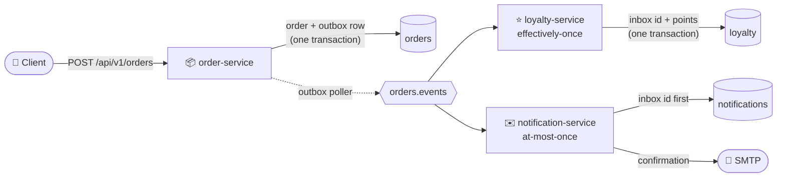
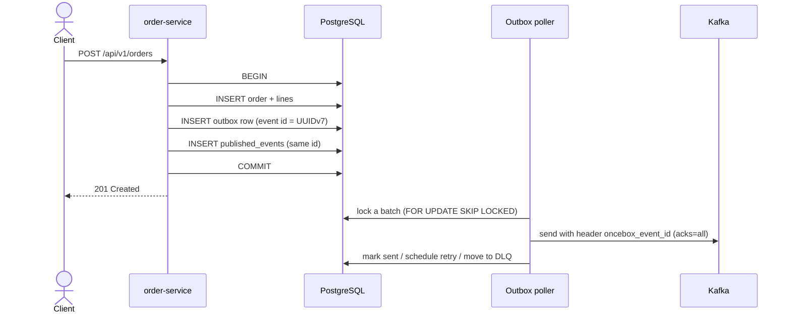
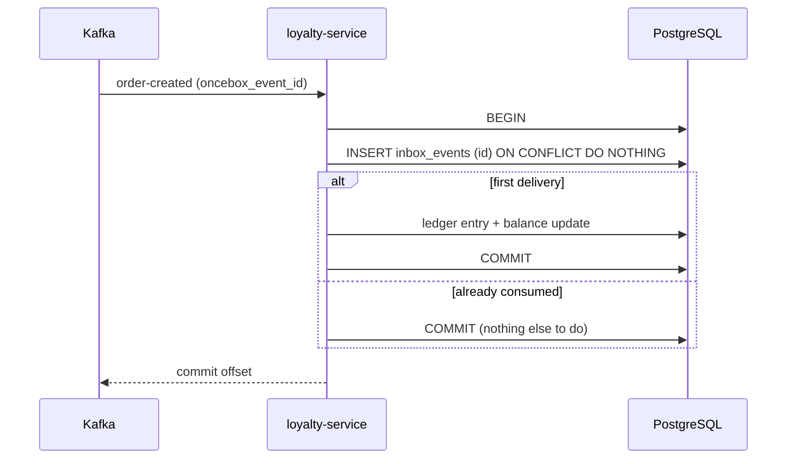
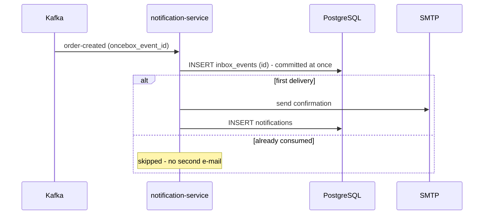

<div align="center">

# 📥 Spring Boot Transactional Inbox

### Kafka will deliver it again. Your services won't do it twice.

[](https://github.com/dmitriy-iliyov/spring-transactional-inbox/actions/workflows/ci.yml)
[](https://codecov.io/gh/dmitriy-iliyov/spring-transactional-inbox)
[](https://openjdk.org/)
[](https://spring.io/projects/spring-boot)
[](https://kafka.apache.org/)
[](https://www.postgresql.org/)
[](https://github.com/dmitriy-iliyov/oncebox)
[](LICENSE)

</div>

A customer places an order. The loyalty service gives them 26 points and the notification service sends a
confirmation. Then a consumer restarts before it commits its offset, Kafka hands the same event over once more - and
the customer ends up with 52 points and two identical e-mails.

This repository is a set of Spring Boot services where that cannot happen. Every consumed event id is recorded in a
**transactional inbox**: a redelivered event is recognised and skipped, whatever the reason it came back. On the
producer side a **transactional outbox** makes sure an event exists exactly when the change that caused it is
committed - never before, never lost.

> 🧩 **Built on [oncebox](https://github.com/dmitriy-iliyov/oncebox)** - a transactional outbox and inbox for
> Spring Boot: polling publication to Kafka or RabbitMQ with retries and a DLQ, and idempotent consumption with
> effectively-once and at-most-once modes. Every service here runs on it: the outbox in `order-service`, the inbox in
> `loyalty-service` and `notification-service`.

## 📑 Contents

- [Highlights](#-highlights)
- [Why an inbox?](#-why-an-inbox)
- [Architecture](#%EF%B8%8F-architecture)
- [How it works](#-how-it-works)
- [Delivery guarantees](#%EF%B8%8F-delivery-guarantees)
- [Quick start](#-quick-start)
- [See the inbox at work](#-see-the-inbox-at-work)
- [Tests](#-tests)
- [Modules](#-modules)

## ✨ Highlights

- 🔁 **Duplicates are a no-op.** The same event id delivered twice changes nothing the second time - no error, no
  retry, no dead letter, just a skip.
- 🎯 **Two guarantees, chosen per side effect.** Database writes get *effectively-once*: the inbox record and the
  effect commit together. E-mails get *at-most-once*: the id is recorded before sending, so a confirmation is never
  sent twice.
- 📤 **Atomic publishing.** The order, its outbox row and the event log entry are one transaction; a poller sends the
  event with `acks=all`, retries with backoff and parks what keeps failing.
- 🔀 **No ordering assumed.** A cancellation that overtakes its order is handled - the points balance ends the same
  whichever event arrives first.
- 🔒 **Safe under concurrency.** Two events of one customer at once cannot lose an update: optimistic locking rolls
  the loser back together with its inbox record, and Kafka redelivers it onto fresh state.
- 🪦 **Nothing silently dropped.** An event that fails all retries lands on `orders.events.DLT` instead of being
  committed past.
- 🧾 **Standard errors and docs.** Every error is an [RFC 9457](https://www.rfc-editor.org/rfc/rfc9457) problem
  detail; APIs are described with OpenAPI.

## 🤔 Why an inbox?

Kafka delivers **at least once**. A redelivery is not an edge case - it is the normal answer to a consumer crash
after the work and before the offset commit, to a rebalance in the middle of a batch, or to an operator replaying a
topic after an incident. Every consumer that changes state has to survive the same event twice.

| Approach | ✅ Pros | ⚠️ Cons |
|----------|---------|---------|
| **No deduplication** | ✅ Nothing to build | ❌ Every redelivery repeats the side effect: points accrued twice, e-mails sent twice |
| **Natural keys / unique constraints** | ✅ No extra table | ❌ Works only where the effect has a natural key<br>❌ A duplicate surfaces as an error to retry or park, not as a no-op<br>❌ Says nothing about effects outside the database |
| **Transactional inbox** *(this project)* | ✅ One table of consumed event ids, for any kind of effect<br>✅ The id and the effect commit together - or, for effects that cannot be undone, the id commits first<br>✅ A duplicate is a skip, not an error | ⚠️ Every consumed event costs one insert<br>⚠️ The id table needs scheduled clean-up by TTL (built in) |

## 🏗️ Architecture



| Service | Listens to | Does | Mode |
|---------|------------|------|------|
| 📦 `order-service` | HTTP | stores orders, publishes `order-created` / `order-cancelled` | transactional outbox |
| ⭐ `loyalty-service` | `order-created`, `order-cancelled` | accrues and reverts loyalty points | `@TransactionalConsumer` |
| ✉️ `notification-service` | `order-created` | sends an order confirmation e-mail | `@NonTransactionalConsumer` |

## 🔄 How it works

### 📤 Publishing - `order-service`



If the transaction rolls back, there is no event. If Kafka is down, the event waits in the table and is retried with
backoff. The id it gets here travels as the `oncebox_event_id` header - the id every consumer deduplicates on.

### ⭐ Effectively-once - `loyalty-service`



The event id and the points are **one transaction**. If anything fails - a lost connection, an optimistic locking
conflict on the balance - both roll back, the error handler redelivers the event with backoff, and the retry runs as
if it were the first time.

### ✉️ At-most-once - `notification-service`



An e-mail cannot be taken back, so the inbox records the event **before** sending. A duplicate is skipped - and so
is a redelivery of an event whose sending failed: a missing confirmation is preferred to a double one, and the
failure is logged with the event ids.

## 🛡️ Delivery guarantees

| Hop | Guarantee | How |
|-----|-----------|-----|
| order change → Kafka | **at-least-once** | transactional outbox, `acks=all`, retries with backoff, DLQ table |
| Kafka → `loyalty-service` | **effectively-once** | inbox id and effect in one transaction |
| Kafka → `notification-service` | **at-most-once** | inbox id committed before the e-mail |
| an event that fails every retry | **parked** | `orders.events.DLT` |

## 🚀 Quick start

You need **Java 21**, **Maven 3.9+** and **Docker**.

**1. Start the infrastructure** - PostgreSQL, Kafka with its topics, and Mailpit to catch e-mails:

```bash
docker compose up -d
```

**2. Build and start the services** (one terminal each):

```bash
mvn clean install -DskipTests

mvn -pl order-service spring-boot:run -Dspring-boot.run.profiles=dev
mvn -pl loyalty-service spring-boot:run -Dspring-boot.run.profiles=dev
mvn -pl notification-service spring-boot:run -Dspring-boot.run.profiles=dev
```

| | URL |
|---|---|
| 📦 order-service | http://localhost:8080 |
| ⭐ loyalty-service | http://localhost:8081 |
| ✉️ notification-service | http://localhost:8082 |
| 📮 Mailpit | http://localhost:8025 |

**3. Place an order:**

```bash
curl -X POST http://localhost:8080/api/v1/orders \
  -H "Content-Type: application/json" \
  -d '{
    "customerId": 42,
    "customerEmail": "jane.doe@example.com",
    "currency": "EUR",
    "lines": [
      {"productId": "sku-1", "quantity": 2, "unitPrice": 10.50},
      {"productId": "sku-2", "quantity": 1, "unitPrice": 5.25}
    ]
  }'
```

**4. Watch it arrive** - points for every whole euro, and a confirmation in [Mailpit](http://localhost:8025):

```bash
curl http://localhost:8081/api/v1/customers/42/points
# {"customerId":42,"balance":26,"updatedAt":"..."}

curl "http://localhost:8082/api/v1/notifications?orderId=1"
# [{"eventId":"...","orderId":1,"recipient":"jane.doe@example.com","subject":"Your order 1 is confirmed",...}]
```

**5. Cancel it** - the points go back:

```bash
curl -X POST http://localhost:8080/api/v1/orders/1/cancel \
  -H "Content-Type: application/json" \
  -d '{"reason": "Ordered by mistake"}'

curl http://localhost:8081/api/v1/customers/42/points
# {"customerId":42,"balance":0,"updatedAt":"..."}
```

Errors come back as RFC 9457 problem details, with a `type` a client can branch on:

```json
{
  "type": "https://github.com/dmitriy-iliyov/spring-transactional-inbox/errors/order-not-found",
  "title": "Order not found",
  "status": 404,
  "detail": "Order 999 not found",
  "instance": "/api/v1/orders/999",
  "path": "/api/v1/orders/999",
  "timestamp": "2026-11-14T10:00:00Z"
}
```

## 🔁 See the inbox at work

Send the last `order-created` event to Kafka **once more, under its original id** - exactly what a consumer restart
or a topic replay would do:

```bash
EVENT=$(docker compose exec -T postgres psql -U inbox -d orders -Atc \
  "SELECT id || ' ' || payload FROM published_events
   WHERE event_type = 'order-created' ORDER BY published_at DESC LIMIT 1")

printf 'oncebox_event_id:%s,oncebox_event_type:order-created\t%s\n' "${EVENT%% *}" "${EVENT#* }" \
  | docker compose exec -T kafka /opt/kafka/bin/kafka-console-producer.sh \
      --bootstrap-server localhost:29092 --topic orders.events --reader-property parse.headers=true
```

Both consumers receive it, and both skip it:

```bash
curl http://localhost:8081/api/v1/customers/42/points   # same balance as before
curl http://localhost:8025/api/v1/messages              # still one confirmation
```

## 🧪 Tests

`mvn clean verify` runs every test against real PostgreSQL and Kafka in Testcontainers (Docker required) and keeps
each module at **80%+ line coverage** with JaCoCo. The flow tests send events exactly the way the outbox does and
stage the situations the inbox exists for:

- ✅ the same event id delivered twice - points accrued and e-mail sent once
- ✅ handling fails, the inbox record rolls back with it, the retry succeeds - points accrued once
- ✅ a cancellation that overtakes its order - balance stays at zero
- ✅ an event of a type no consumer knows - parked on the dead letter topic, never recorded as consumed
- ✅ an order whose event log write fails - neither the order nor its outbox row is stored

See [CONTRIBUTING.md](CONTRIBUTING.md) for the test conventions.

## 📦 Modules

| Module | Purpose |
|--------|---------|
| `inbox-events-contract` | event types, topic names and payload records shared by producer and consumers |
| `order-service` | orders API, transactional outbox, `published_events` log |
| `loyalty-service` | points ledger and balances, effectively-once inbox, points API |
| `notification-service` | order confirmation e-mails, at-most-once inbox, notifications API |

## 🤝 Contributing

Contributions are welcome - from a version bump to a new consumer. Issues labelled
[`good first issue`](https://github.com/dmitriy-iliyov/spring-transactional-inbox/issues?q=is%3Aissue+is%3Aopen+label%3A%22good+first+issue%22)
are self-contained and come with a clear definition of done. Start with [CONTRIBUTING.md](CONTRIBUTING.md).

## 📚 Learn more

- 🧩 [oncebox](https://github.com/dmitriy-iliyov/oncebox) - the outbox and inbox library behind these services
- 📖 [oncebox documentation](https://dmitriy-iliyov.github.io/oncebox-docs/) - configuration, guarantees, schema
- 🔐 [Security policy](SECURITY.md)

## 📄 License

[Apache License 2.0](LICENSE)
